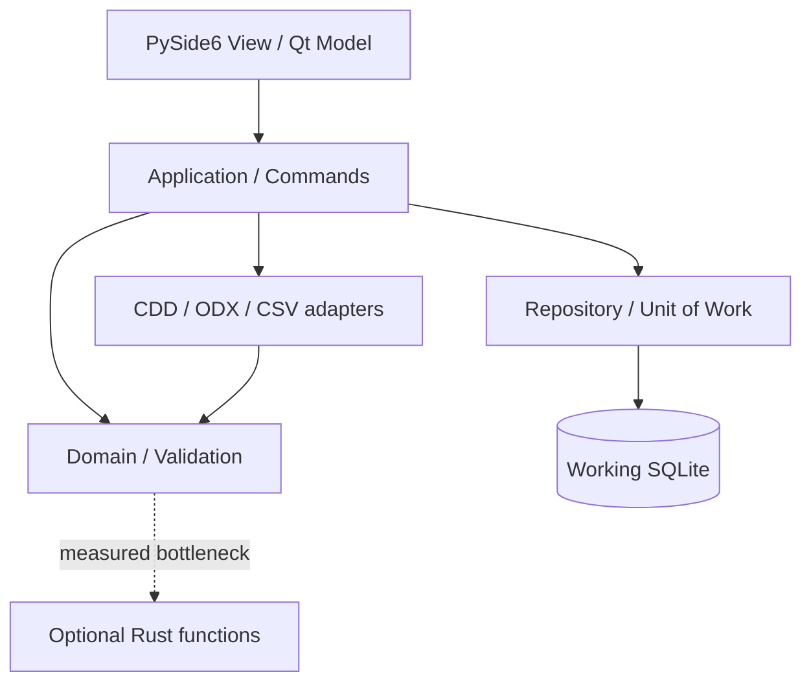

# 시스템 아키텍처

[목차](README.md) · [도메인](06-domain-model.md) · [저장](08-editing-save-recovery.md) · [인터페이스](10-interfaces-and-rust.md)

## 책임과 의존성

도메인은 PySide6·sqlite3·lxml을 import하지 않는다. 파일 어댑터는 도메인 입력 DTO를 생성하며 Repository를 직접 수정하지 않는다. Rust는 데이터베이스 연결을 받지 않는다.

| 논리 모듈 | 책임 | 하지 않는 일 |
|---|---|---|
| ui | 화면·delegate·Qt model·사용자 선택 | SQL, XML 파싱, 전체 검증 |
| application | 명령, 세션, 작업 큐, 저장·출력 조정 | 위젯 직접 조작 |
| domain | 값 객체, 그래프 규칙, 배치, Decimal 변환 | 파일 IO, DB 연결, Qt signal |
| persistence | 쿼리, DTO 매핑, 트랜잭션, 스키마 마이그레이션 | 진단 규칙 우회 |
| interchange | 버전별 CDD 읽기, ODX 쓰기, CSV | 직접 편집 DB 변경 |
| workers | 스냅샷 작업, 진행·취소, 결과 전달 | 공유 커넥션 접근 |
| diagnostics | rule/job/revision 중심 로그·진단 정보 | 기본 원문 덤프 |

이 표는 향후 코드 모듈의 책임 계약이며 이번 산출물은 구현 파일이 아니다.

## 상태와 연결 소유권

Working DB가 편집 상태의 기준이다. 도메인 객체는 명령 수행 중의 불변 스냅샷/작업 값이며 두 번째 영속 모델을 만들지 않는다. Qt model은 페이지와 객체 표시 DTO를 캐시하고 커밋 후 change set으로 무효화한다.

DB 전담 작업 스레드가 하나의 쓰기 커넥션과 쿼리 큐를 소유한다. check_same_thread를 끄고 커넥션을 공유하지 않는다. 읽기 전용 백그라운드 작업은 독립 스냅샷 파일과 자체 커넥션을 사용한다. GUI 스레드는 모든 Qt 모델 변경 알림을 수행한다.

일반 쿼리는 페이지 200행을 기본으로 한다. 캐시는 현재 페이지와 인접 페이지만 유지한다. 셀 data() 호출은 캐시 조회만 수행한다. 검색은 DB 스레드에서 파라미터 바인딩으로 실행하며 허용된 정렬 필드만 선택한다.

## 명령 처리 흐름

1. UI가 입력 DTO와 expected_revision을 제출한다.
2. 응용 계층이 현재 revision·읽기 전용·잠금·지원 범위를 검사한다.
3. BEGIN IMMEDIATE 후 필요한 그래프를 읽고 변경안을 계산한다.
4. 지역 도메인 규칙과 관계 일관성을 검사한다.
5. 변경·undo 정보·audit·새 state token·revision을 같은 트랜잭션으로 저장한다.
6. COMMIT 성공 후 affected_ids, invalidated_scopes를 GUI에 전달한다.
7. 실패 시 ROLLBACK하고 UI의 확정 표시를 복원한다.

외부 입력을 파싱하는 시간 동안 쓰기 트랜잭션을 열지 않는다. CDD·CSV는 임시 DTO와 검사 결과를 만든 뒤 적용 단계만 하나의 트랜잭션으로 수행한다.

## 비동기 작업

CPU 사용량이 큰 Python 검증·변환은 별도 프로세스에서 실행한다. Windows spawn 진입점과 배포 실행파일에서의 자식 프로세스 시작을 초기 배포 실험에서 확인한다. 짧은 DB 작업과 파일 백업 조정은 DB 작업 스레드에서 실행한다.

스냅샷에는 project_id, revision, profile_version, schema_version을 붙인다. 결과 revision이 현재 문서와 다르면 검증 결과는 stale로 표시한다. 출력은 시작 시 고정한 revision의 결과로 유효하며 보고서와 완료 화면에 이를 표시한다. 최신 문서 출력인 것처럼 표시하지 않는다.

취소는 협력적이다. 파싱·객체 변환의 배치 경계에서 토큰을 검사한다. 커밋 직전 취소는 rollback, 커밋 이후 취소는 해당 명령을 소급 취소하지 않는다. 필요하면 사용자 Undo를 제공한다.

## 오류와 운영

예상 오류는 code, message, object_id, field, retryable, details DTO로 변환한다. 저장 공간 부족·잠금·손상·버전·검증 오류를 구분한다. 예상하지 못한 예외는 job_id를 사용자에게 보여주고 구조화 로그를 남긴다.

예상 검증 오류를 Python exception 흐름으로 대량 전달하지 않는다. ValidationIssue 목록으로 반환한다. 부분 가져오기는 결과 상태 partial로 명시하고 오류 통계를 숨기지 않는다.

공식 UI 기술 참고: [Qt for Python](https://doc.qt.io/qtforpython-6/), [QAbstractTableModel](https://doc.qt.io/qtforpython-6/PySide6/QtCore/QAbstractTableModel.html).
