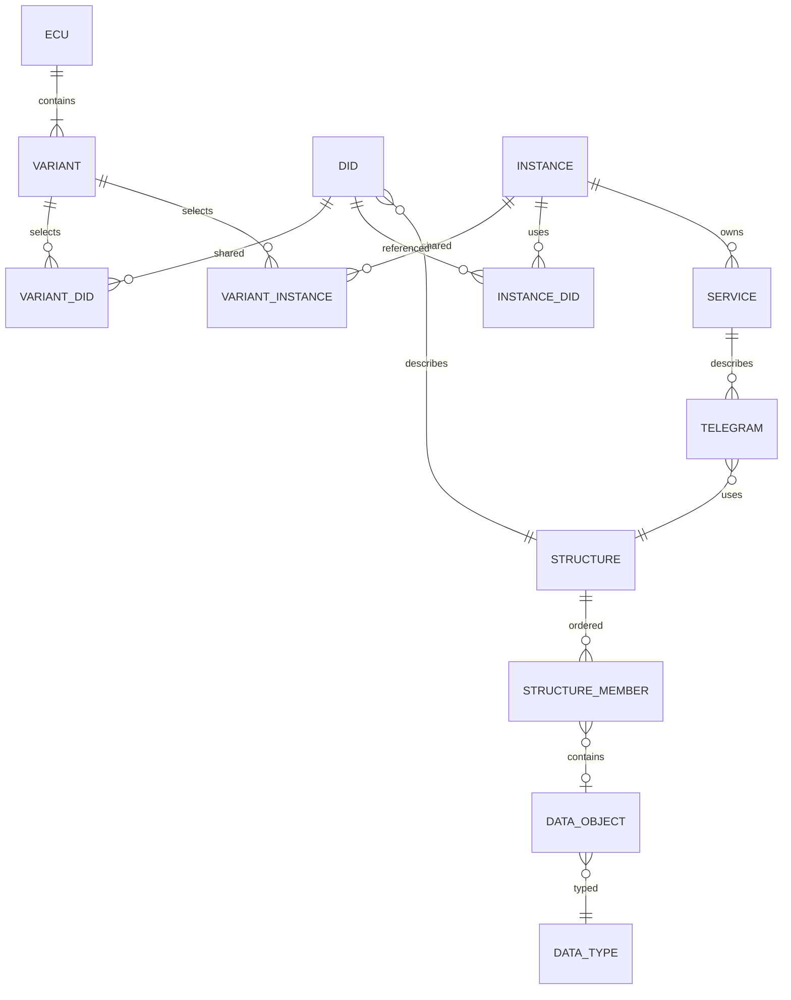

# SQLite 데이터베이스 명세

[목차](README.md) · [도메인](06-domain-model.md) · [저장 프로토콜](08-editing-save-recovery.md)

## 파일·연결 계약

`.diagproj`는 SQLite 파일이다. application_id는 0x44494147(DIAG), user_version은 최초 1이다. project_meta.schema_version과 user_version을 함께 검증한다. 아래 DDL은 최초 스키마이며 migration용 ALTER 스크립트가 아니다. 각 연결에서 foreign_keys를 ON으로 설정한다. 쓰기 연결은 autocommit 방식에서 명시적 BEGIN IMMEDIATE/COMMIT을 사용한다.

작업 DB: journal_mode=WAL, synchronous=FULL, busy_timeout=5000ms. 전달용 DB: journal_mode=DELETE, clean close, sidecar 불필요. 연결 설정은 DB 전담 스레드에서 수행한다. WAL 파일의 존재를 프로젝트 저장 완료로 간주하지 않는다.

## 관계도



## 그룹과 컬럼 해석

| 테이블 그룹 | 컬럼·역할·제약 |
|---|---|
| project_meta / schema_migrations | 단일 프로젝트 UUID·revision·언어·프로파일·스키마, migration 버전·해시·시각 |
| objects / localized_texts | 공통 UUID·kind·qualifier·지원 상태, 이름/설명의 언어별 값과 검색 키 |
| ecu / variants | 하나의 ECU와 복수 변형; partial unique index로 기본 변형 최대 1개 |
| identifier_scopes | UDS DID/routine 16비트, DTC 24비트의 식별 범위 |
| dids / dtcs | 업무 번호와 정의, 같은 번호의 다른 변형별 객체 허용 |
| variant_dids / variant_dtcs | 변형별 유일 번호; 복합 FK로 정의의 번호와 연결 행의 번호를 일치시킴 |
| diagnostic_classes / diagnostic_instances / services | 사용 사례·인스턴스·서비스의 소유 구조 |
| instance_dids / variant_instances | 인스턴스의 DID 사용과 변형에서의 공유 |
| variant_classes (schema 4) | 변형에 포함된 진단 클래스와 문서 순서. `diagnostic_classes.singleton`, `variant_instances.ordinal`과 함께 탐색 트리 배치를 정한다 |
| nrcs / protocol_services / job_containers / variant_jobs (schema 5) | 템플릿 NRC 목록, 프로토콜 서비스 읽기 전용 요약, Job 컨테이너와 변형별 순서. `diagnostic_instances.owner_variant_id`는 원본 변형(CDD DIAGINST 위치) |
| command_receipts (schema 6) | 명령 ID 재시도 영수증(요청 해시·결과 revision·선택 객체). 실행 취소 이력과 스냅샷에서 제외 |
| structure_members.kind dtc·iteration, min_items (schema 7) | dtc = 변형 DTC 표의 24비트 DTC 값, iteration = 전용 항목 구조를 PDU 끝까지 반복(최소 반복 수). 0x19·0x14 전문용 |
| snapshot_records / snapshot_default_dids / snapshot_dtc_dids / extended_records, structure_members fault_record·record_role·label (schema 8) | 고장 메모리 인스턴스의 스냅샷 레코드 번호·DID 목록(기본, DTC별), 확장 데이터 레코드 번호·구조. 전문의 sr/sd/edr/ed 자리. 예약 비트 이름 |
| data_types / conversion_entries | 길이·인코딩(schema 9: packed BCD)·가변 바이트 필드의 최소·최대 길이·변환식·범위별 텍스트 |
| structures / data_objects / structure_members / telegrams | 순서 있는 데이터 구조와 요청·응답 연결 |
| state_groups / states / service_conditions / service_transitions | 그룹별 허용과 결정적 전이 |
| source_files / source_mappings / unsupported_nodes / import_issues | 원본 바이트·노드 대응·미지원 의미·오류 |
| object_attributes | 선택적 확장 속성; 핵심 관계를 대신하는 JSON 저장소로 쓰지 않음 |
| change_log / undo_stack / history_state | 감사 이벤트, 현재 세션 undo 프레임, cursor와 저장 체크포인트 |

모든 TEXT 시각은 UTC ISO-8601, UUID는 정규 소문자 하이픈 형식이다. CHECK length는 최소 DB 방어이며 실제 UUID/시각 파싱은 도메인에서 수행한다. qualifier의 유일 범위와 객체 kind/subtype 일치는 VAL-013/VAL-016에서 검사한다.

## 정확한 수치와 인덱스

업무 코드(u16/u24), revision, ordinal은 INTEGER다. 원시 정수 리터럴·선형 계수·경계값은 TEXT다. u64 최댓값 18446744073709551615를 REAL로 바꾸지 않는다. raw 정렬이 필요하면 Python int/Decimal 또는 정규화 정렬 키를 사용하고 CAST(... AS INTEGER/REAL)를 쓰지 않는다. [SQLite 타입](https://www.sqlite.org/datatype3.html)

코드 조회는 membership 복합 unique index, 역참조는 대상 FK 인덱스, qualifier·이름은 정규화 검색 키를 사용한다. `%문자열%` 검색은 일반 B-tree가 가속한다고 가정하지 않는다. 2만 행 기준을 측정하고 필요한 경우 후속 인덱스/FTS를 검토한다.

## 최초 스키마 DDL

```sql
PRAGMA foreign_keys = ON;
PRAGMA application_id = 0x44494147;
PRAGMA user_version = 1;

CREATE TABLE project_meta (
  singleton INTEGER PRIMARY KEY CHECK(singleton=1),
  project_uuid TEXT NOT NULL UNIQUE CHECK(length(project_uuid)=36),
  schema_version INTEGER NOT NULL CHECK(schema_version>=1),
  revision INTEGER NOT NULL DEFAULT 0 CHECK(revision>=0),
  default_locale TEXT NOT NULL,
  profile_id TEXT NOT NULL,
  profile_version TEXT NOT NULL,
  saved_app_version TEXT NOT NULL,
  created_at TEXT NOT NULL,
  updated_at TEXT NOT NULL
) STRICT;

CREATE TABLE schema_migrations (
  to_version INTEGER PRIMARY KEY CHECK(to_version>=1),
  from_version INTEGER NOT NULL CHECK(from_version>=0),
  script_sha256 TEXT NOT NULL CHECK(length(script_sha256)=64),
  applied_at TEXT NOT NULL,
  CHECK(to_version=from_version+1)
) STRICT;

CREATE TABLE source_files (
  id TEXT PRIMARY KEY CHECK(length(id)=36),
  kind TEXT NOT NULL CHECK(kind IN ('cdd','csv','other')),
  basename TEXT NOT NULL,
  format_version TEXT,
  sha256 TEXT NOT NULL UNIQUE CHECK(length(sha256)=64),
  content BLOB NOT NULL,
  imported_at TEXT NOT NULL
) STRICT;

CREATE TABLE objects (
  id TEXT PRIMARY KEY CHECK(length(id)=36),
  kind TEXT NOT NULL CHECK(kind IN (
    'ecu','variant','did','dtc','diagnostic_class','diagnostic_instance',
    'service','data_type','data_object','structure','state_group','state',
    'nrc','protocol_service','job_container','snapshot_record','extended_record')),
  qualifier TEXT NOT NULL,
  qualifier_key TEXT NOT NULL,
  supported INTEGER NOT NULL DEFAULT 1 CHECK(supported IN (0,1)),
  read_only INTEGER NOT NULL DEFAULT 0 CHECK(read_only IN (0,1))
) STRICT;
CREATE INDEX ix_objects_qualifier ON objects(kind,qualifier_key,id);

CREATE TABLE localized_texts (
  object_id TEXT NOT NULL REFERENCES objects(id) ON DELETE CASCADE,
  field TEXT NOT NULL CHECK(field IN ('name','description')),
  locale TEXT NOT NULL,
  value TEXT NOT NULL,
  search_key TEXT NOT NULL,
  PRIMARY KEY(object_id,field,locale)
) STRICT;
CREATE INDEX ix_text_search ON localized_texts(field,locale,search_key,object_id);

CREATE TABLE source_mappings (
  id INTEGER PRIMARY KEY,
  object_id TEXT NOT NULL REFERENCES objects(id) ON DELETE CASCADE,
  source_file_id TEXT NOT NULL REFERENCES source_files(id) ON DELETE RESTRICT,
  node_path TEXT NOT NULL,
  external_id TEXT,
  external_oid TEXT,
  UNIQUE(object_id,source_file_id,node_path)
) STRICT;
CREATE INDEX ix_source_external ON source_mappings(source_file_id,external_id);

CREATE TABLE object_attributes (
  object_id TEXT NOT NULL REFERENCES objects(id) ON DELETE CASCADE,
  key TEXT NOT NULL,
  value_type TEXT NOT NULL CHECK(value_type IN ('text','integer','decimal','boolean','hex')),
  value_text TEXT NOT NULL,
  PRIMARY KEY(object_id,key)
) STRICT;

CREATE TABLE ecu (
  id TEXT PRIMARY KEY REFERENCES objects(id) ON DELETE RESTRICT,
  project_singleton INTEGER NOT NULL UNIQUE REFERENCES project_meta(singleton) ON DELETE RESTRICT,
  manufacturer TEXT NOT NULL DEFAULT ''
) STRICT;

CREATE TABLE variants (
  id TEXT PRIMARY KEY REFERENCES objects(id) ON DELETE RESTRICT,
  ecu_id TEXT NOT NULL REFERENCES ecu(id) ON DELETE RESTRICT,
  is_base INTEGER NOT NULL DEFAULT 0 CHECK(is_base IN (0,1)),
  ordinal INTEGER NOT NULL CHECK(ordinal>=0),
  locked INTEGER NOT NULL DEFAULT 0 CHECK(locked IN (0,1)),
  created_from_variant_id TEXT REFERENCES variants(id) ON DELETE SET NULL,
  UNIQUE(ecu_id,ordinal)
) STRICT;
CREATE UNIQUE INDEX ux_base_variant ON variants(ecu_id) WHERE is_base=1;

CREATE TABLE identifier_scopes (
  id TEXT PRIMARY KEY,
  protocol TEXT NOT NULL CHECK(protocol='UDS'),
  kind TEXT NOT NULL CHECK(kind IN ('did','dtc','routine')),
  bit_length INTEGER NOT NULL,
  CHECK((kind IN ('did','routine') AND bit_length=16) OR (kind='dtc' AND bit_length=24))
) STRICT;

CREATE TABLE structures (
  id TEXT PRIMARY KEY REFERENCES objects(id) ON DELETE RESTRICT,
  kind TEXT NOT NULL CHECK(kind IN ('payload','packet','bitfield'))
) STRICT;

CREATE TABLE data_types (
  id TEXT PRIMARY KEY REFERENCES objects(id) ON DELETE RESTRICT,
  -- schema 9: bcd = packed BCD(한 자리 4비트). 근거: 도움말 110_ODXExport 표 31 numBCD → A_UINT32, BASE-TYPE-ENCODING BCD-P.
  encoding TEXT NOT NULL CHECK(encoding IN ('unsigned','signed','ascii','bytes','packet','bcd')),
  bit_length INTEGER,
  byte_order TEXT NOT NULL DEFAULT 'big' CHECK(byte_order IN ('big','little')),
  array_length INTEGER,
  conversion TEXT NOT NULL CHECK(conversion IN ('identity','linear','text_table')),
  factor_text TEXT,
  offset_text TEXT,
  unit TEXT NOT NULL DEFAULT '',
  structure_id TEXT REFERENCES structures(id) ON DELETE RESTRICT,
  -- schema 2: 선형 변환의 원시값 유효 범위(NULL=제한 없음). 마이그레이션의 ALTER TABLE과 같은 정의를 쓴다.
  raw_lower TEXT CHECK(raw_lower IS NULL OR conversion='linear'),
  raw_upper TEXT CHECK(raw_upper IS NULL OR conversion='linear'),
  -- schema 9: PDU 끝까지 이어지는 가변 바이트 필드(array_length NULL)의 최소 바이트 수.
  -- 근거: CDD SIMPLEPROXYCOMP dest=any(maxbl 없음) = UDS-ExampleEcu.pdx DtcSnapshotRecordNumber
  -- (A_BYTEFIELD, MIN-MAX-LENGTH-TYPE, TERMINATION=END-OF-PDU, MIN-LENGTH).
  min_length INTEGER CHECK(min_length IS NULL OR min_length BETWEEN 0 AND 1048576),
  -- 가변 바이트 필드의 최대 바이트 수(NULL = 제한 없음). CDD IDENT qty=field의 maxsz. ODX MIN-MAX-LENGTH-TYPE/MAX-LENGTH.
  max_length INTEGER CHECK(max_length IS NULL OR (min_length IS NOT NULL AND max_length BETWEEN min_length AND 1048576)),
  CHECK((encoding='packet' AND structure_id IS NOT NULL AND bit_length IS NULL
         AND array_length IS NULL AND conversion='identity' AND min_length IS NULL)
     OR (encoding IN ('unsigned','signed') AND structure_id IS NULL
         AND bit_length IS NOT NULL AND array_length IS NOT NULL
         AND bit_length BETWEEN 1 AND 64 AND array_length=1 AND min_length IS NULL)
     OR (encoding='bcd' AND structure_id IS NULL AND bit_length BETWEEN 4 AND 32 AND bit_length%4=0
         AND array_length=1 AND conversion='identity' AND min_length IS NULL)
     OR (encoding IN ('ascii','bytes') AND structure_id IS NULL
         AND bit_length IS NOT NULL AND array_length IS NOT NULL
         AND bit_length=8 AND array_length BETWEEN 1 AND 1048576 AND conversion='identity' AND min_length IS NULL)
     OR (encoding='bytes' AND structure_id IS NULL AND bit_length=8 AND array_length IS NULL
         AND min_length IS NOT NULL AND conversion='identity')),
  CHECK((conversion='linear' AND factor_text IS NOT NULL AND offset_text IS NOT NULL)
     OR (conversion!='linear' AND factor_text IS NULL AND offset_text IS NULL))
) STRICT;
CREATE INDEX ix_types_structure ON data_types(structure_id);

CREATE TABLE conversion_entries (
  data_type_id TEXT NOT NULL REFERENCES data_types(id) ON DELETE CASCADE,
  ordinal INTEGER NOT NULL CHECK(ordinal>=0),
  locale TEXT NOT NULL,
  lower_raw TEXT NOT NULL,
  upper_raw TEXT NOT NULL,
  label TEXT NOT NULL,
  PRIMARY KEY(data_type_id,ordinal,locale)
) STRICT;

CREATE TABLE data_objects (
  id TEXT PRIMARY KEY REFERENCES objects(id) ON DELETE RESTRICT,
  data_type_id TEXT NOT NULL REFERENCES data_types(id) ON DELETE RESTRICT,
  default_kind TEXT CHECK(default_kind IN ('integer','decimal','text','hex')),
  default_text TEXT,
  constant_kind TEXT CHECK(constant_kind IN ('integer','decimal','text','hex')),
  constant_text TEXT,
  CHECK((default_kind IS NULL)=(default_text IS NULL)),
  CHECK((constant_kind IS NULL)=(constant_text IS NULL))
) STRICT;
CREATE INDEX ix_data_objects_type ON data_objects(data_type_id);

CREATE TABLE dids (
  id TEXT PRIMARY KEY REFERENCES objects(id) ON DELETE RESTRICT,
  scope_id TEXT NOT NULL REFERENCES identifier_scopes(id) ON DELETE RESTRICT,
  identifier INTEGER NOT NULL CHECK(identifier BETWEEN 0 AND 65535),
  structure_id TEXT NOT NULL REFERENCES structures(id) ON DELETE RESTRICT,
  UNIQUE(id,scope_id,identifier)
) STRICT;
CREATE INDEX ix_dids_structure ON dids(structure_id);

CREATE TABLE dtcs (
  id TEXT PRIMARY KEY REFERENCES objects(id) ON DELETE RESTRICT,
  scope_id TEXT NOT NULL REFERENCES identifier_scopes(id) ON DELETE RESTRICT,
  code INTEGER NOT NULL CHECK(code BETWEEN 0 AND 16777215),
  UNIQUE(id,scope_id,code)
) STRICT;

CREATE TABLE variant_dids (
  variant_id TEXT NOT NULL REFERENCES variants(id) ON DELETE CASCADE,
  did_id TEXT NOT NULL,
  scope_id TEXT NOT NULL,
  identifier INTEGER NOT NULL,
  PRIMARY KEY(variant_id,did_id),
  UNIQUE(variant_id,scope_id,identifier),
  FOREIGN KEY(did_id,scope_id,identifier) REFERENCES dids(id,scope_id,identifier)
    ON UPDATE CASCADE ON DELETE RESTRICT
) STRICT;
CREATE INDEX ix_variant_dids_target ON variant_dids(did_id);

CREATE TABLE variant_dtcs (
  variant_id TEXT NOT NULL REFERENCES variants(id) ON DELETE CASCADE,
  dtc_id TEXT NOT NULL,
  scope_id TEXT NOT NULL,
  code INTEGER NOT NULL,
  PRIMARY KEY(variant_id,dtc_id),
  UNIQUE(variant_id,scope_id,code),
  FOREIGN KEY(dtc_id,scope_id,code) REFERENCES dtcs(id,scope_id,code)
    ON UPDATE CASCADE ON DELETE RESTRICT
) STRICT;
CREATE INDEX ix_variant_dtcs_target ON variant_dtcs(dtc_id);

CREATE TABLE diagnostic_classes (
  id TEXT PRIMARY KEY REFERENCES objects(id) ON DELETE RESTRICT,
  role TEXT NOT NULL CHECK(role IN ('session','reset','read','write','routine','tester_present','fault_memory'))
) STRICT;

CREATE TABLE diagnostic_instances (
  id TEXT PRIMARY KEY REFERENCES objects(id) ON DELETE RESTRICT,
  class_id TEXT NOT NULL REFERENCES diagnostic_classes(id) ON DELETE RESTRICT
) STRICT;
CREATE INDEX ix_instances_class ON diagnostic_instances(class_id);

CREATE TABLE instance_dids (
  instance_id TEXT NOT NULL REFERENCES diagnostic_instances(id) ON DELETE CASCADE,
  did_id TEXT NOT NULL REFERENCES dids(id) ON DELETE RESTRICT,
  role TEXT NOT NULL CHECK(role IN ('read','write','data')),
  PRIMARY KEY(instance_id,did_id,role)
) STRICT;
CREATE INDEX ix_instance_dids_target ON instance_dids(did_id);

CREATE TABLE variant_instances (
  variant_id TEXT NOT NULL REFERENCES variants(id) ON DELETE CASCADE,
  instance_id TEXT NOT NULL REFERENCES diagnostic_instances(id) ON DELETE RESTRICT,
  PRIMARY KEY(variant_id,instance_id)
) STRICT;
CREATE INDEX ix_variant_instances_target ON variant_instances(instance_id);

CREATE TABLE services (
  id TEXT PRIMARY KEY REFERENCES objects(id) ON DELETE RESTRICT,
  instance_id TEXT NOT NULL REFERENCES diagnostic_instances(id) ON DELETE RESTRICT,
  sid INTEGER NOT NULL CHECK(sid IN (16,17,34,46,49,62)),
  subfunction INTEGER CHECK(subfunction BETWEEN 0 AND 127),
  routine_identifier INTEGER CHECK(routine_identifier BETWEEN 0 AND 65535),
  physical INTEGER NOT NULL DEFAULT 1 CHECK(physical IN (0,1)),
  functional INTEGER NOT NULL DEFAULT 0 CHECK(functional IN (0,1)),
  suppress_positive INTEGER NOT NULL DEFAULT 0 CHECK(suppress_positive IN (0,1)),
  enabled INTEGER NOT NULL DEFAULT 1 CHECK(enabled IN (0,1)),
  CHECK(physical=1 OR functional=1),
  CHECK((sid=49 AND routine_identifier IS NOT NULL) OR (sid!=49 AND routine_identifier IS NULL)),
  CHECK((sid IN (16,17,49,62) AND subfunction IS NOT NULL)
     OR (sid IN (34,46) AND subfunction IS NULL AND suppress_positive=0))
) STRICT;
CREATE INDEX ix_services_instance ON services(instance_id);

CREATE TABLE service_nrcs (
  service_id TEXT NOT NULL REFERENCES services(id) ON DELETE CASCADE,
  code INTEGER NOT NULL CHECK(code BETWEEN 1 AND 255),
  PRIMARY KEY(service_id,code)
) STRICT;

CREATE TABLE telegrams (
  id TEXT PRIMARY KEY CHECK(length(id)=36),
  service_id TEXT NOT NULL REFERENCES services(id) ON DELETE RESTRICT,
  kind TEXT NOT NULL CHECK(kind IN ('request','positive','negative')),
  structure_id TEXT NOT NULL REFERENCES structures(id) ON DELETE RESTRICT,
  UNIQUE(service_id,kind)
) STRICT;
CREATE INDEX ix_telegrams_structure ON telegrams(structure_id);

CREATE TABLE structure_members (
  structure_id TEXT NOT NULL REFERENCES structures(id) ON DELETE CASCADE,
  ordinal INTEGER NOT NULL CHECK(ordinal>=0),
  -- schema 10: mux = 선택자 값에 따라 케이스 구조가 정해지는 자리(CDD MUXDT·MUXCOMP). 선택자·케이스는 muxes·mux_cases.
  kind TEXT NOT NULL CHECK(kind IN ('data','reserved','structure','did_data','did_with_identifier','literal','dtc','iteration','fault_record','mux')),
  data_object_id TEXT UNIQUE REFERENCES data_objects(id) ON DELETE RESTRICT,
  nested_structure_id TEXT REFERENCES structures(id) ON DELETE RESTRICT,
  did_id TEXT REFERENCES dids(id) ON DELETE RESTRICT,
  reserved_bits INTEGER CHECK(reserved_bits>0),
  literal_bytes BLOB,
  -- schema 7: iteration = 중첩 구조(항목)를 PDU 끝까지 반복(ODX END-OF-PDU-FIELD). min_items는 최소 반복 수.
  --           dtc = 변형 DTC 표의 24비트 DTC 값(ODX DTC-DOP 참조).
  min_items INTEGER CHECK(min_items IS NULL OR min_items>=0),
  -- schema 8: fault_record = 고장 메모리 레코드 자리. sr/edr = 스냅샷·확장 데이터 레코드 번호(8비트),
  --           sd/ed = 번호·DTC에 따라 내용이 정해지는 레코드 데이터(가변 길이, snapshot_*·extended_records 참조).
  record_role TEXT CHECK(record_role IS NULL OR record_role IN ('sr','sd','edr','ed')),
  -- schema 8: 예약 비트의 원래 이름(CDD GAPDATAOBJ 등). 표시·ODX SHORT-NAME용.
  label TEXT CHECK(label IS NULL OR kind='reserved'),
  PRIMARY KEY(structure_id,ordinal),
  CHECK((kind='data' AND data_object_id IS NOT NULL AND nested_structure_id IS NULL
         AND did_id IS NULL AND reserved_bits IS NULL AND literal_bytes IS NULL AND min_items IS NULL)
     OR (kind='structure' AND data_object_id IS NULL AND nested_structure_id IS NOT NULL
         AND did_id IS NULL AND reserved_bits IS NULL AND literal_bytes IS NULL AND min_items IS NULL)
     OR (kind IN ('did_data','did_with_identifier') AND data_object_id IS NULL
         AND nested_structure_id IS NULL AND did_id IS NOT NULL AND reserved_bits IS NULL AND literal_bytes IS NULL AND min_items IS NULL)
     OR (kind='reserved' AND data_object_id IS NULL AND nested_structure_id IS NULL
         AND did_id IS NULL AND reserved_bits IS NOT NULL AND literal_bytes IS NULL AND min_items IS NULL)
     OR (kind='literal' AND data_object_id IS NULL AND nested_structure_id IS NULL
         AND did_id IS NULL AND reserved_bits IS NULL AND literal_bytes IS NOT NULL AND length(literal_bytes)>0 AND min_items IS NULL)
     OR (kind='dtc' AND data_object_id IS NULL AND nested_structure_id IS NULL
         AND did_id IS NULL AND reserved_bits IS NULL AND literal_bytes IS NULL AND min_items IS NULL)
     OR (kind='iteration' AND data_object_id IS NULL AND nested_structure_id IS NOT NULL
         AND did_id IS NULL AND reserved_bits IS NULL AND literal_bytes IS NULL AND min_items IS NOT NULL)
     OR (kind IN ('fault_record','mux') AND data_object_id IS NULL AND nested_structure_id IS NULL
         AND did_id IS NULL AND reserved_bits IS NULL AND literal_bytes IS NULL AND min_items IS NULL)),
  CHECK((kind='fault_record') = (record_role IS NOT NULL))
) STRICT;
CREATE INDEX ix_members_did ON structure_members(did_id);
CREATE INDEX ix_members_nested ON structure_members(nested_structure_id);

-- schema 10: MUX 자리의 선택자(같은 전문의 앞쪽 데이터 객체)와 선택자 값 범위별 케이스 구조, 기본 구조(없으면 NULL).
CREATE TABLE muxes (
  structure_id TEXT NOT NULL,
  ordinal INTEGER NOT NULL,
  selector_object_id TEXT NOT NULL REFERENCES data_objects(id) ON DELETE RESTRICT,
  default_structure_id TEXT REFERENCES structures(id) ON DELETE RESTRICT,
  PRIMARY KEY(structure_id,ordinal),
  FOREIGN KEY(structure_id,ordinal) REFERENCES structure_members(structure_id,ordinal) ON DELETE CASCADE
) STRICT;
CREATE INDEX ix_muxes_selector ON muxes(selector_object_id);
CREATE INDEX ix_muxes_default ON muxes(default_structure_id);

CREATE TABLE mux_cases (
  structure_id TEXT NOT NULL,
  ordinal INTEGER NOT NULL,
  case_ordinal INTEGER NOT NULL CHECK(case_ordinal>=0),
  lower_raw TEXT NOT NULL,
  upper_raw TEXT NOT NULL,
  case_structure_id TEXT NOT NULL REFERENCES structures(id) ON DELETE RESTRICT,
  PRIMARY KEY(structure_id,ordinal,case_ordinal),
  FOREIGN KEY(structure_id,ordinal) REFERENCES muxes(structure_id,ordinal) ON DELETE CASCADE
) STRICT;
CREATE INDEX ix_mux_cases_structure ON mux_cases(case_structure_id);

CREATE TABLE state_groups (
  id TEXT PRIMARY KEY REFERENCES objects(id) ON DELETE RESTRICT,
  -- schema 10: authorization(UDS 13 템플릿)과 'other:<qualifier>'(spec 없는 그룹). 두 종류는 ODX 대응 미확인(가져오기에서 supported=0).
  kind TEXT NOT NULL UNIQUE CHECK(kind IN ('session','security','authorization') OR kind GLOB 'other:*'),
  initial_state_id TEXT NOT NULL,
  FOREIGN KEY(initial_state_id,id) REFERENCES states(id,group_id)
    DEFERRABLE INITIALLY DEFERRED
) STRICT;

CREATE TABLE states (
  id TEXT PRIMARY KEY REFERENCES objects(id) ON DELETE RESTRICT,
  group_id TEXT NOT NULL REFERENCES state_groups(id) ON DELETE RESTRICT,
  code INTEGER NOT NULL CHECK(code BETWEEN 0 AND 255),
  UNIQUE(group_id,code),
  UNIQUE(id,group_id)
) STRICT;

CREATE TABLE service_conditions (
  service_id TEXT NOT NULL REFERENCES services(id) ON DELETE CASCADE,
  group_id TEXT NOT NULL REFERENCES state_groups(id) ON DELETE RESTRICT,
  state_id TEXT NOT NULL,
  allowed INTEGER NOT NULL CHECK(allowed IN (0,1)),
  PRIMARY KEY(service_id,group_id,state_id),
  FOREIGN KEY(state_id,group_id) REFERENCES states(id,group_id) ON DELETE RESTRICT
) STRICT;
CREATE INDEX ix_conditions_state ON service_conditions(state_id);

CREATE TABLE service_transitions (
  service_id TEXT NOT NULL,
  group_id TEXT NOT NULL,
  from_state_id TEXT NOT NULL,
  to_state_id TEXT NOT NULL,
  PRIMARY KEY(service_id,group_id,from_state_id),
  FOREIGN KEY(service_id,group_id,from_state_id)
    REFERENCES service_conditions(service_id,group_id,state_id) ON DELETE CASCADE,
  FOREIGN KEY(to_state_id,group_id) REFERENCES states(id,group_id) ON DELETE RESTRICT
) STRICT;
CREATE INDEX ix_transitions_target ON service_transitions(to_state_id);

CREATE TABLE unsupported_nodes (
  id INTEGER PRIMARY KEY,
  source_file_id TEXT NOT NULL REFERENCES source_files(id) ON DELETE RESTRICT,
  owner_object_id TEXT REFERENCES objects(id) ON DELETE RESTRICT,
  node_path TEXT NOT NULL,
  reason_code TEXT NOT NULL,
  semantic INTEGER NOT NULL CHECK(semantic IN (0,1)),
  raw_xml TEXT NOT NULL,
  UNIQUE(source_file_id,node_path,reason_code)
) STRICT;
CREATE INDEX ix_unsupported_owner ON unsupported_nodes(owner_object_id);

CREATE TABLE import_issues (
  id INTEGER PRIMARY KEY,
  source_file_id TEXT NOT NULL REFERENCES source_files(id) ON DELETE RESTRICT,
  object_id TEXT REFERENCES objects(id) ON DELETE SET NULL,
  node_path TEXT,
  code TEXT NOT NULL,
  severity TEXT NOT NULL CHECK(severity IN ('info','warning','error')),
  blocks_export INTEGER NOT NULL CHECK(blocks_export IN (0,1)),
  message TEXT NOT NULL
) STRICT;
CREATE INDEX ix_import_issues_source ON import_issues(source_file_id,severity);

CREATE TABLE change_log (
  revision INTEGER PRIMARY KEY CHECK(revision>=1),
  event_id TEXT NOT NULL UNIQUE CHECK(length(event_id)=36),
  command_id TEXT NOT NULL,
  action TEXT NOT NULL CHECK(action IN ('execute','undo','redo','migrate')),
  affected_ids_json TEXT NOT NULL CHECK(json_valid(affected_ids_json)),
  before_json TEXT NOT NULL CHECK(json_valid(before_json)),
  after_json TEXT NOT NULL CHECK(json_valid(after_json)),
  occurred_at TEXT NOT NULL
) STRICT;

CREATE TABLE undo_stack (
  position INTEGER PRIMARY KEY CHECK(position>=1),
  command_id TEXT NOT NULL UNIQUE,
  forward_json TEXT NOT NULL CHECK(json_valid(forward_json)),
  inverse_json TEXT NOT NULL CHECK(json_valid(inverse_json)),
  before_token TEXT NOT NULL,
  after_token TEXT NOT NULL
) STRICT;

CREATE TABLE history_state (
  singleton INTEGER PRIMARY KEY CHECK(singleton=1),
  cursor_position INTEGER NOT NULL CHECK(cursor_position>=0),
  current_token TEXT NOT NULL,
  saved_token TEXT
) STRICT;
```

## DB 제약과 응용 검사의 경계

DB가 보장: FK, 범위(u16/u24), 기본 변형 최대 1개, 변형별 번호 유일성, 정의와 membership 번호 일치, 그룹을 벗어난 상태 참조 금지, 멤버 종류별 필드 조합, JSON 문법.

응용 계층이 커밋 전에 보장: 정확히 하나의 ECU·기본 변형, scope의 kind와 대상 종류 일치, objects/subtype의 1:1 대응, qualifier 범위 유일성, 구조/타입/DID 순환 없음, 참조 DID의 모든 사용 변형 포함, 정규 Decimal·raw 문자열, 전이 출발 상태 allowed=true, 조건 행렬 완전성, undo cursor/token 일관성. SQL로 보장하지 않은 항목을 보장한다고 표시하지 않는다.

범위 UNIQUE 오류는 사용자 메시지로 변환한다. 영향 검사 후에도 DB 제약은 최종 방어로 유지한다. membership에 복제된 identifier/code는 조회·제약용이며 복합 FK의 ON UPDATE CASCADE로 정의 값과 항상 일치한다.

## 마이그레이션

DDL을 적용하기 전에 원본을 백업 API로 보존한다. 기존 schema version을 기준으로 연속 migration만 적용하며 대상 버전을 건너뛰지 않는다. 작업본에서 BEGIN IMMEDIATE → migration SQL → domain 재검증 → foreign_key_check → user_version/project_meta 갱신 → audit → COMMIT을 수행한다. 실패는 ROLLBACK하고 원본을 유지한다. 미래 버전은 읽기 전용 메타데이터 확인 또는 열기 거부로 처리하며 쓰지 않는다.

```sql-- schema 8: 고장 메모리 인스턴스의 스냅샷·확장 데이터 레코드(CDD DIAGINST/FAULTMEMORY).
-- 스냅샷: 레코드 번호 목록과, 레코드에 담기는 DID 목록(기본 + DTC별 대체).
CREATE TABLE snapshot_records (
  id TEXT PRIMARY KEY REFERENCES objects(id) ON DELETE RESTRICT,
  instance_id TEXT NOT NULL REFERENCES diagnostic_instances(id) ON DELETE RESTRICT,
  number INTEGER NOT NULL CHECK(number BETWEEN 0 AND 255),
  UNIQUE(instance_id,number)
) STRICT;
CREATE INDEX ix_snapshot_records_instance ON snapshot_records(instance_id);

CREATE TABLE snapshot_default_dids (
  instance_id TEXT NOT NULL REFERENCES diagnostic_instances(id) ON DELETE CASCADE,
  ordinal INTEGER NOT NULL CHECK(ordinal>=0),
  did_id TEXT NOT NULL REFERENCES dids(id) ON DELETE RESTRICT,
  PRIMARY KEY(instance_id,ordinal)
) STRICT;
CREATE INDEX ix_snapshot_default_did ON snapshot_default_dids(did_id);

CREATE TABLE snapshot_dtc_dids (
  instance_id TEXT NOT NULL REFERENCES diagnostic_instances(id) ON DELETE CASCADE,
  dtc_id TEXT NOT NULL REFERENCES dtcs(id) ON DELETE CASCADE,
  ordinal INTEGER NOT NULL CHECK(ordinal>=0),
  did_id TEXT NOT NULL REFERENCES dids(id) ON DELETE RESTRICT,
  PRIMARY KEY(instance_id,dtc_id,ordinal)
) STRICT;
CREATE INDEX ix_snapshot_dtc_did ON snapshot_dtc_dids(did_id);
CREATE INDEX ix_snapshot_dtc_dtc ON snapshot_dtc_dids(dtc_id);

-- 확장 데이터: 레코드 번호별 데이터 구조.
CREATE TABLE extended_records (
  id TEXT PRIMARY KEY REFERENCES objects(id) ON DELETE RESTRICT,
  instance_id TEXT NOT NULL REFERENCES diagnostic_instances(id) ON DELETE RESTRICT,
  number INTEGER NOT NULL CHECK(number BETWEEN 0 AND 255),
  structure_id TEXT NOT NULL REFERENCES structures(id) ON DELETE RESTRICT,
  UNIQUE(instance_id,number)
) STRICT;
CREATE INDEX ix_extended_records_instance ON extended_records(instance_id);
CREATE INDEX ix_extended_records_structure ON extended_records(structure_id);
```

### schema 11 (28차)

변형 식별 패턴(ODX ECU-VARIANT-PATTERN)과 미지원 서비스 부정 응답 NRC(ODX GLOBAL-NEG-RESPONSE). 10 → 11 마이그레이션은 빈 표를 만든다(기존 프로젝트의 보존 원문은 다시 해석하지 않음).

```sql
-- schema 11: 변형 식별 패턴(CDD VAR/IDENTIFICATIONSET → ODX ECU-VARIANT-PATTERN). 패턴 하나 = 모두 맞아야 하는 조건 여러 개.
-- 조건 = 식별 서비스(DIAG-COMM)의 긍정 응답 데이터 객체(parameter = Qualifier)의 기대값(expected_value, 물리값 글자).
-- 근거: CANoe 예제 UDS-ExampleEcu-5.0.4.cdd ↔ 같은 문서의 Vector 출력 UDS-ExampleEcu-5.0.2.pdx(Part_Number = "Developer ECU").
CREATE TABLE variant_patterns (
  variant_id TEXT NOT NULL REFERENCES variants(id) ON DELETE CASCADE,
  pattern INTEGER NOT NULL CHECK(pattern>=1),
  ordinal INTEGER NOT NULL CHECK(ordinal>=1),
  service_id TEXT NOT NULL REFERENCES services(id) ON DELETE RESTRICT,
  parameter TEXT NOT NULL,
  expected_value TEXT NOT NULL,
  PRIMARY KEY(variant_id,pattern,ordinal)
) STRICT;
CREATE INDEX ix_variant_patterns_service ON variant_patterns(service_id);

-- schema 11: 지원하지 않는 서비스 요청의 부정 응답 NRC(CDD UNSUPPSRVNEG → ODX GLOBAL-NEG-RESPONSE, 7F SID NRC).
CREATE TABLE unsupported_service_nrcs (
  nrc_id TEXT PRIMARY KEY REFERENCES nrcs(id) ON DELETE CASCADE,
  ordinal INTEGER NOT NULL CHECK(ordinal>=0)
) STRICT;
```

### schema 12 (29차)

`data_types.conversion`에 `formula`(CDD FORMULADT)를 더하고 수식 원문 열 `formula_expression`을 둔다. 수식은 계산하지 않는다. ODX는 Vector 출력(UDS-ExampleEcu.pdx EngineTemperature)과 같이 IDENTICAL + DESC 수식 문구, 물리 타입 = 부호화 타입, 단위 없음. 11 → 12 마이그레이션은 CHECK 변경이라 `data_types`를 다시 만들고 기존 행을 그대로 옮긴다.

```sql
  conversion TEXT NOT NULL CHECK(conversion IN ('identity','linear','text_table','formula')),
  -- …
  formula_expression TEXT,
  CHECK((conversion='formula' AND formula_expression IS NOT NULL AND length(trim(formula_expression))>0 AND encoding IN ('unsigned','signed'))
     OR (conversion!='formula' AND formula_expression IS NULL))
```

### schema 13 (30차)

`data_types.encoding`에 `float`(IEEE 754 32·64비트, 동일값·선형 변환), `conversion`에 `scale_linear`(CDD 여러 구간 COMPTBL → ODX SCALE-LINEAR)·`tab_intp`(CDD VALTBL → ODX TAB-INTP), 열 `leading_length_bits`(가변 바이트 필드의 앞 길이 바이트 8/16/24/32비트, ODX LEADING-LENGTH-INFO-TYPE), 표 `conversion_segments`를 더한다. 근거는 Door CDD ↔ UDS-ExampleEcu-5.0.2.pdx(VehicleSpeed, TestDatatypePiecewiseLinear, TestDatatypeCharacteristicCurve, Memory_n_Byte_Size_Info). 12 → 13 마이그레이션은 CHECK 변경이라 `data_types`를 다시 만들고 기존 행을 옮긴다.

```sql
CREATE TABLE conversion_segments (
  data_type_id TEXT NOT NULL REFERENCES data_types(id) ON DELETE CASCADE,
  ordinal INTEGER NOT NULL CHECK(ordinal>=0),
  lower_raw TEXT NOT NULL,
  upper_raw TEXT,          -- scale_linear 구간 상한(tab_intp 점은 NULL)
  factor_text TEXT,        -- scale_linear 계수
  offset_text TEXT,        -- scale_linear 오프셋
  value_text TEXT,         -- tab_intp 점의 물리값
  PRIMARY KEY(data_type_id,ordinal)
) STRICT;
```
